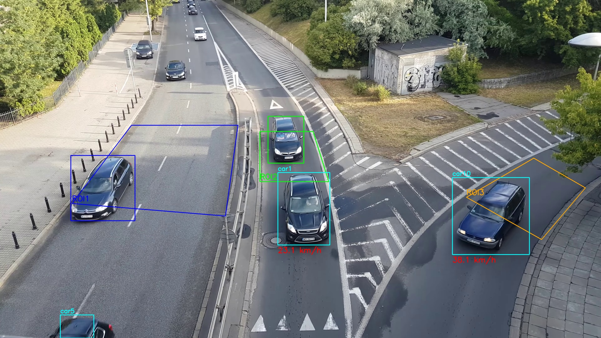
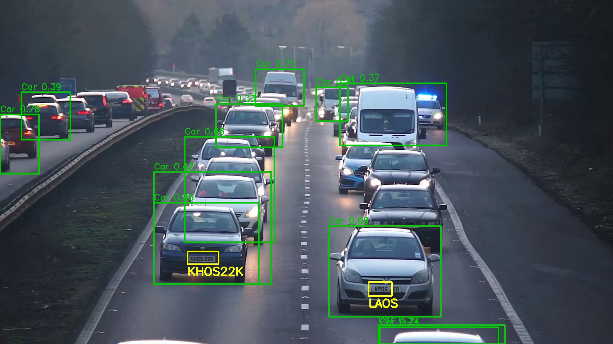
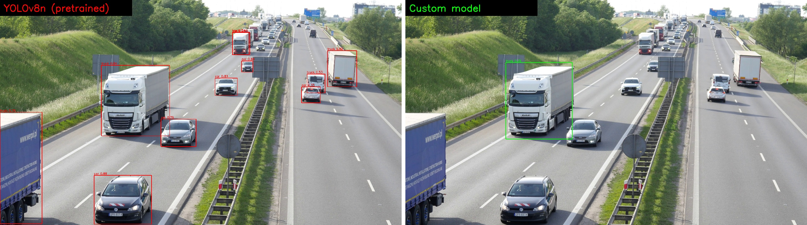
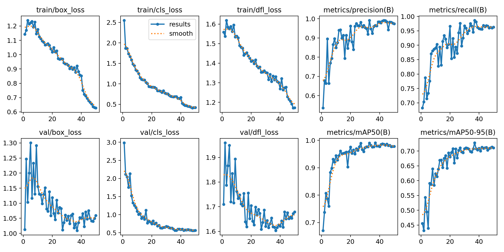
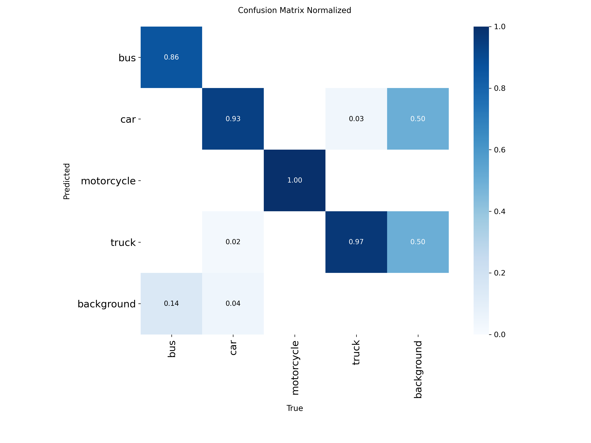

# Real-Time Traffic Monitoring & Analytics System

An end-to-end traffic analysis solution built with **YOLOv8**, **ByteTrack** and **Tesseract OCR**, integrated into an interactive **Streamlit** dashboard.

The system processes real-world traffic video to perform vehicle detection, automatic number plate recognition (ANPR) and vehicle tracking for speed estimation.



---

## Key Features

- **Vehicle Detection & Benchmarking**
  - Custom YOLOv8 models fine-tuned from `YOLOv8n` for vehicle identification (`bus`, `car`, `motorcycle`, `truck`).
  - Side-by-side comparison of the custom model against the pre-trained `YOLOv8n`.
- **Automatic Number Plate Recognition (ANPR)**
  - Dedicated YOLO model to locate license plates.
  - Each plate is cropped, converted to grayscale and read with `pytesseract` (single-line mode, alphanumeric whitelist).
- **Speed Estimation & Multi-Object Tracking**
  - Vehicles are tracked across frames with **ByteTrack**, keeping a persistent ID per vehicle.
  - Speed is computed from the time each vehicle needs to cross a Region of Interest (ROI) of known real-world length.
- **Pedestrian Detection & Tracking**
  - A separate YOLO model trained on pedestrians, with a dedicated tracking app.
- **Interactive Streamlit Dashboard** (`final_app.py`), with three tabs:
  - **Model Comparison:** custom vs. pre-trained YOLO on the same video, side by side.
  - **ANPR & Detection:** vehicle and license plate boxes with the recognised plate text.
  - **Speed Monitoring:** ROI overlays, per-vehicle speeds and Start / Stop / Reset controls.

---

## Screenshots

**ANPR:** vehicle detection (green) and license plate recognition (yellow)



**Benchmark:** pre-trained YOLOv8n (left) vs. the custom model (right) on the same frame



---

## Training Results

All models were fine-tuned from `yolov8n.pt` for 50 epochs at 640 px. Metrics are measured on the validation set.

| Model | Classes | Precision | Recall | mAP50 | mAP50-95 |
|---|---|---|---|---|---|
| Vehicles (`vehicles_split_run`) | bus, car, motorcycle, truck | 0.974 | 0.963 | 0.978 | 0.711 |
| Cars (`vehicles_custom_run2`) | car | 0.893 | 0.793 | 0.912 | 0.752 |
| License plates (`plates_custom_run`) | plate | 0.937 | 0.901 | 0.947 | 0.674 |
| Pedestrians (`pedestrian_custom_run3`) | pedestrian | 0.979 | 0.982 | 0.993 | 0.933 |

| Vehicle model: training curves | Vehicle model: confusion matrix |
|---|---|
|  |  |

---

## Tech Stack & Libraries

- **Language:** Python
- **Deep Learning / Vision:** Ultralytics YOLOv8, OpenCV
- **Object Tracking:** ByteTrack
- **OCR Engine:** Tesseract (`pytesseract`)
- **Web App / UI:** Streamlit

---

## System Architecture

```text
[Traffic Video Stream]
          │
          ├──> [Vehicle Detection (Custom YOLOv8 / YOLOv8n)] ──> [ByteTrack Tracking & Speed (ROI)]
          │
          └──> [License Plate Detection (YOLO)] ──> [Grayscale crop] ──> [Tesseract OCR]
                                                                                │
[Streamlit Interactive UI] <────────────────────────────────────────────────────┘
```

---

## Running Locally

1. Install [Tesseract OCR](https://github.com/tesseract-ocr/tesseract). The apps expect it at `C:\Program Files\Tesseract-OCR\tesseract.exe`. Change `tesseract_cmd` in the code if yours is elsewhere.
2. Install the Python dependencies:

   ```bash
   pip install -r requirements.txt
   ```

3. Start the dashboard:

   ```bash
   streamlit run final_app.py
   ```

4. Upload a traffic video in any tab. The ROI coordinates in the speed tab are calibrated for a 4K (3840×2160) overhead camera, so adjust them for other footage.

The trained weights are included under `runs/train/*/weights/best.pt`. The training datasets and test videos are not included because of their size (several GB).

## Project Structure

| File | Purpose |
|---|---|
| `final_app.py` | Main Streamlit dashboard (comparison, ANPR, speed) |
| `speed_app.py`, `speedtest.py` | Standalone speed estimation |
| `license_app.py`, `object_and_license_app.py` | ANPR experiments |
| `pedestrian_tracking_app.py` | Pedestrian tracking |
| `compare_app.py` | Model comparison |
| `split_dataset.py`, `verify_dataset.py` | Dataset preparation |
| `*.yaml` | Dataset configurations used for training |
